<div align="center">


# Seeky

**One free desktop player for your local files, YouTube playlists, and Spotify imports.**

[](https://github.com/tarun922/seeky/releases/latest)
[](#-installation)
[](https://discord.gg/Tjv3pa3PU9)
[](https://github.com/tarun922/seeky/stargazers)
[](https://github.com/tarun922/seeky/releases)

<br/>

> Spotify imports. YouTube playlists. Local files. Live lyrics. Song ID. Discord RPC.
> Plugins that search and watch anime and movies.
> All in one gorgeous desktop app. **Free, no ads, no account.**

<br/>

[**⬇️ Download**](https://github.com/tarun922/seeky/releases/latest) &nbsp;·&nbsp;
[What's new](#-whats-new) &nbsp;·&nbsp;
[Installation](#-installation) &nbsp;·&nbsp;
[Features](#-features) &nbsp;·&nbsp;
[Plugins](#-plugins) &nbsp;·&nbsp;
[Roadmap](#%EF%B8%8F-roadmap) &nbsp;·&nbsp;
[Discord](https://discord.gg/Tjv3pa3PU9)

<br/>

### 🔓 Road to Open Source

> **If this repo hits 2,000 ⭐, Seeky goes open source.**
> The full source code will be released, including the powerful **Smart Feed** generator.

[](https://github.com/tarun922/seeky/stargazers)
&nbsp;→&nbsp; **Goal: 2,000**

<br/>

<!-- Replace with a short GIF of theme switching + Now Playing (ScreenToGif / Peek / Kap) -->
<!--  -->

| Home | Now Playing |
|:----:|:-----------:|
| 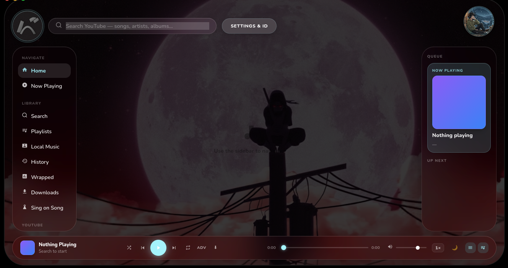 | 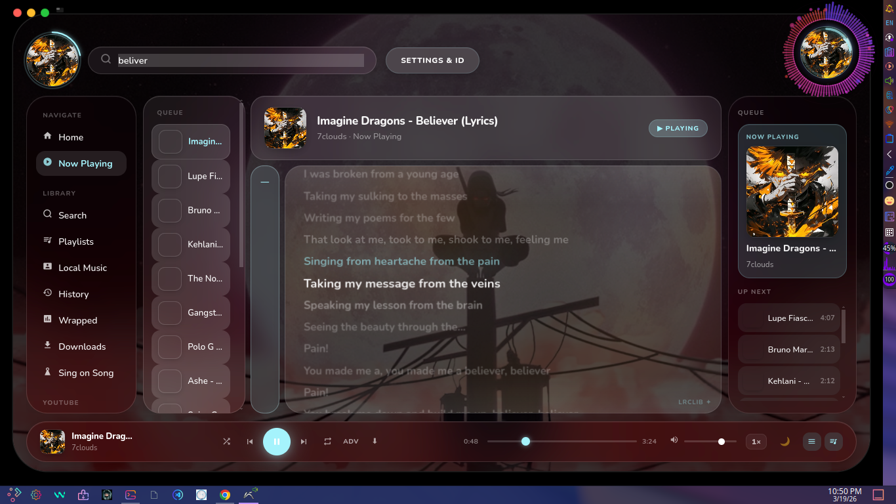 |

</div>

---

## 🆕 What's new

**Latest: [v2.0.5](https://github.com/tarun922/seeky/releases/tag/v2.0.5)**

- 🎌 **Seeky Anime**, a new built-in plugin: browse Trending, Popular, Seasonal and Schedule, then watch with SUB/DUB, subtitles and playback speed, all inside Seeky.
- 📥 **Downloads and offline library**: pick 1080p / 720p / 480p / 360p or audio only, download single episodes or whole batches, and play them offline from *Stored Anime*.
- 📋 **My List and Continue Watching**: track Watching / Completed / Plan to Watch / On Hold / Dropped, and resume exactly where you left off.
- 🛠️ **Reliability and plugin system**: longer timeouts and a live "Starting server…" counter for slow cold starts, automatic port-conflict handling, and plugin files now load in the right order.

[Full release notes →](https://github.com/tarun922/seeky/releases/latest)

---

## ✨ Why Seeky?

Most music apps make you pick a lane: *local only* or *streaming only*. Seeky does both. It's a free, offline-first desktop music hub that pulls everything into one library without the monthly bill.

- **Zero effort listening**: play one song and the Smart Feed keeps the music going
- **No account required**
- **No ads, no upsells**
- **Private by default**: your library and listening data stay on your machine

---

## 🎯 Features

| | |
|---|---|
| 🌊 **Smart Feed** | Play one song and let Seeky do the rest. The feed generator builds an endless queue from your first pick, so you never have to curate a playlist. |
| 🎵 **Play everything** | Local files, YouTube streams, and Spotify-imported playlists in one library. Supports `mp3`, `flac`, `opus`, `ogg`, `wav` and more. |
| 📥 **Spotify import** | Bring your playlists over, subscription or not. |
| 📺 **YouTube playlists** | Paste a playlist URL and play it like a local playlist, with caching for skip-free listening. |
| 🎤 **Live synced lyrics** | Scrolling lyrics on the Now Playing screen. |
| 🕵️ **Song ID** | Press `R` anywhere in the player. Seeky records 8 seconds from your mic and identifies the track via ACRCloud. |
| 📊 **Wrapped, all year** | Top artists, top tracks, listening streaks, total hours. Any time, not just December. |
| 🎮 **Gamer Mode** | Auto-ducks music volume when game audio kicks in. |
| 💬 **Discord Rich Presence** | Shows song, artist, album art, and play state on your profile. |
| 📱 **Mobile remote** | Open Seeky's remote URL on your phone (same Wi-Fi) to control playback. |
| 🪟 **Mini player** | Always-on-top compact controls. |
| ↔️ **Crossfade & visualizer** | Smooth transitions and a real-time visualizer. |
| 🔌 **Plugins** | Extend Seeky with plugins. [See what's available](#-plugins). |
| 🍿 **Anime & movie search** | Plugins that let you search, watch and download anime and movies without leaving the app. |

### 🎨 11 Hand-Crafted Themes

Every theme is hand-crafted, not just a color swap.

<div align="center">

| 🌌 Midnight Aurora | 🕳️ Cosmic Void | 🔴 Molten Obsidian |
|:------------------:|:--------------:|:------------------:|
| 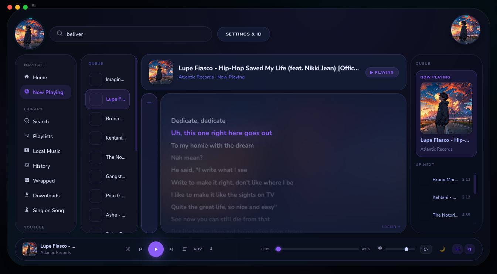 | 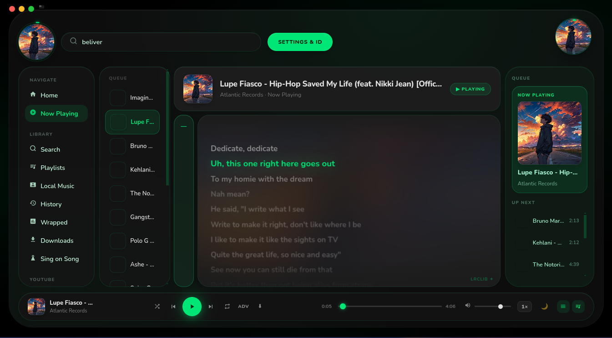 | 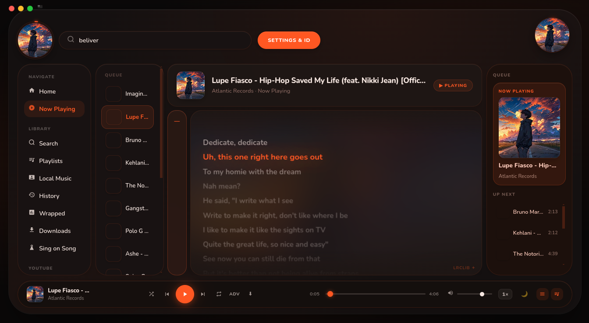 |

| 🔵 Powder Blue | 🌅 Golden Hour | ⬜ Arctic Pearl |
|:--------------:|:--------------:|:---------------:|
| 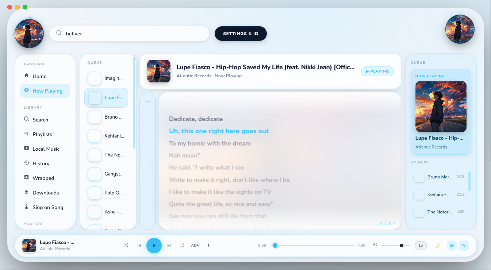 | 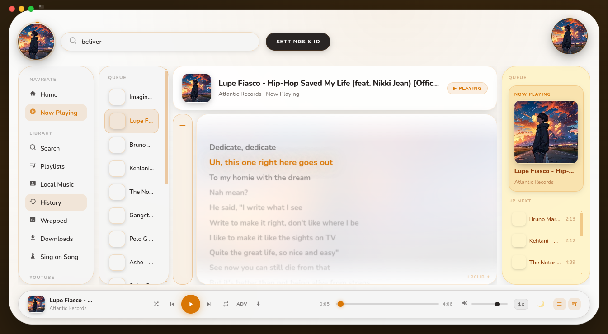 | 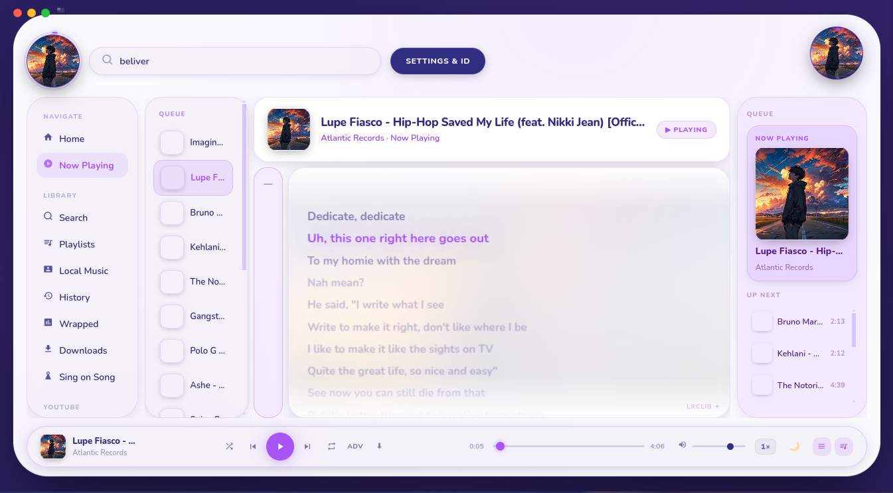 |

| 🖼️ Toon Dark | 🎉 Toob Pop | 🌸 Cute Dark |
|:------------:|:-----------:|:------------:|
| 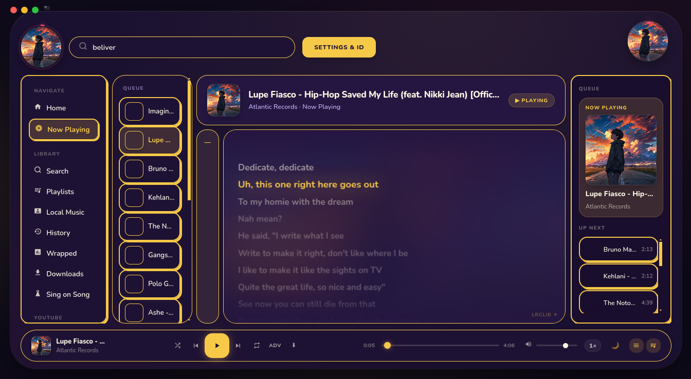 | 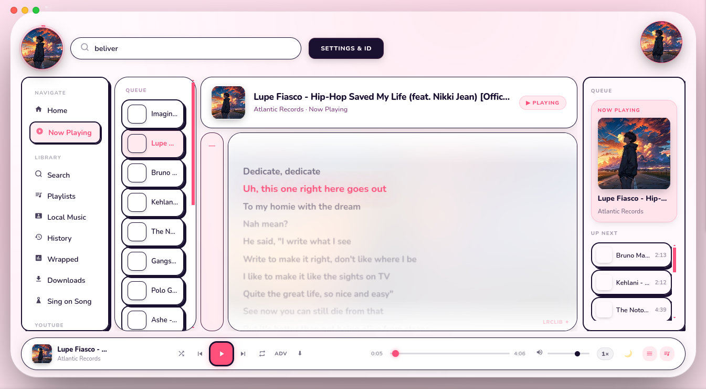 | 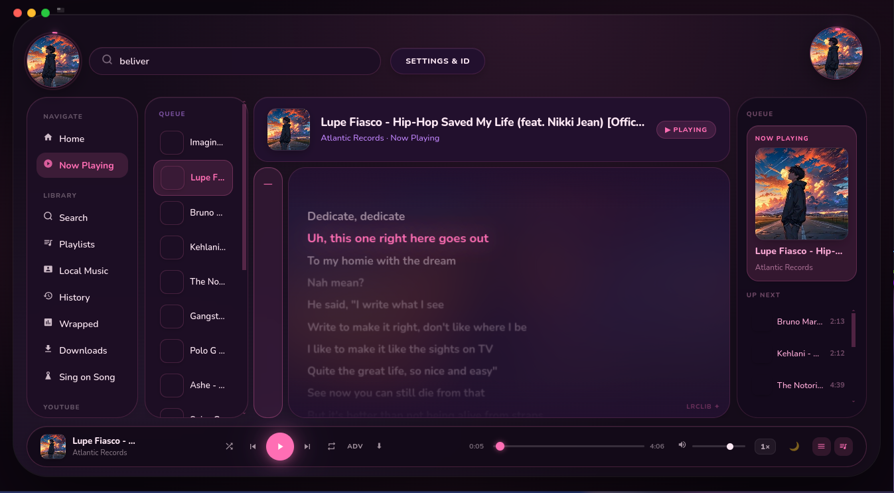 |

| 🍬 Cute Light | 💎 Crystal ✨ |
|:-------------:|:-------------:|
| 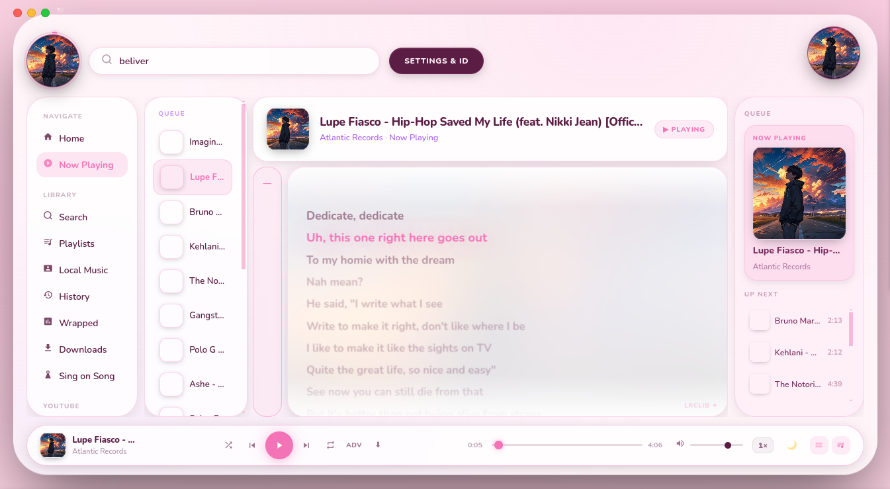 | 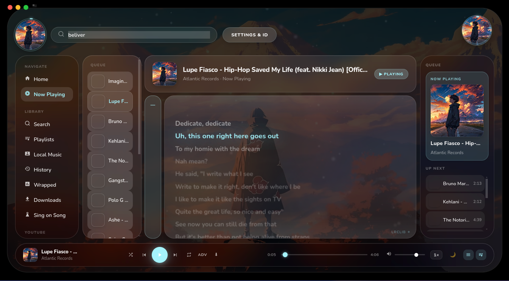 |

> 💎 **Crystal** is Seeky's signature theme, with a custom **live animated background** that reacts to your music in real time.

</div>

---

## 🔌 Plugins

Seeky supports plugins, so the app can do more than play music.

| Plugin | What it does |
|---|---|
| 🎌 **Seeky Anime** | Browse, search, stream and download anime with SUB/DUB, subtitles, My List and an offline library. |
| 🍿 **Movie search** | Search movies right inside Seeky. |
| 🎮 **Gamer Mode** | Built in. Auto-ducks music volume when game audio kicks in. |

<div align="center">

| Anime: Browse & Discover | Anime: Detail & Episodes |
|:------------------------:|:------------------------:|
| 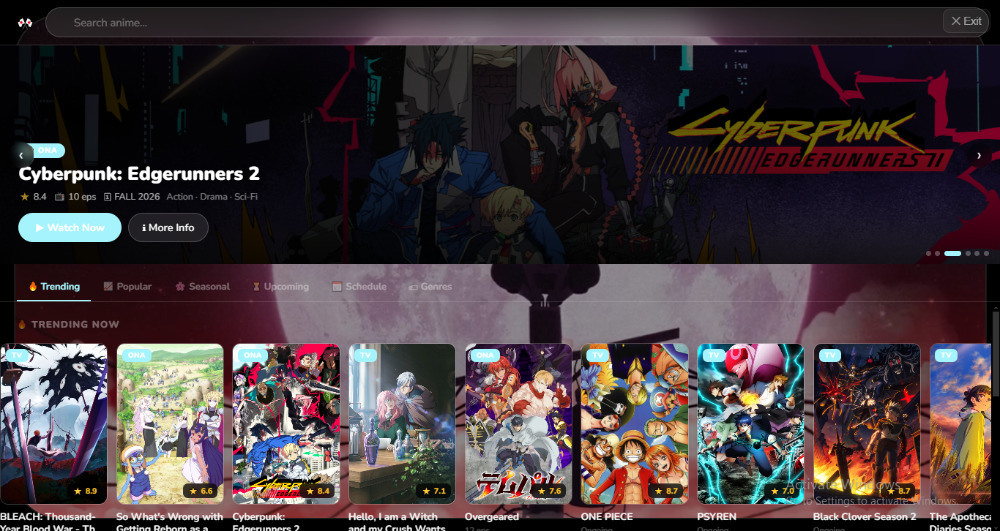 | 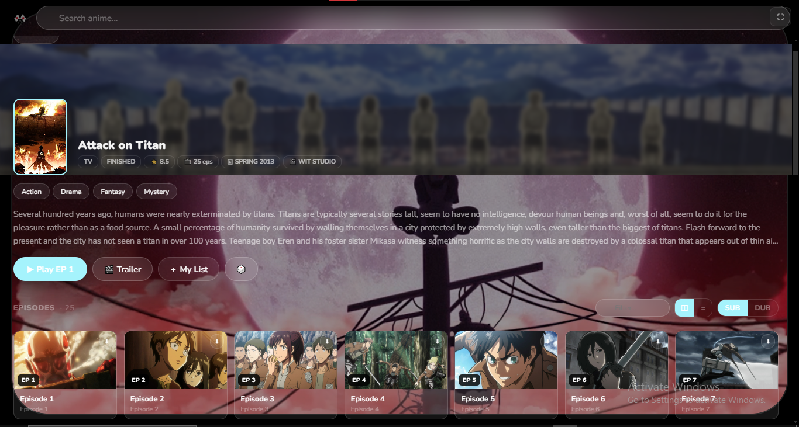 |

| Anime: Player | Movie Search |
|:-------------:|:------------:|
|  |  |

</div>

More plugins and a plugin marketplace are on the [roadmap](#%EF%B8%8F-roadmap).

---

## 📦 Installation

Grab the latest build from the [Releases page](https://github.com/tarun922/seeky/releases/latest).

| Platform | File | Quick install |
|---|---|---|
| 🪟 **Windows** | `Seeky-Setup-x.x.x.exe` | [Jump to steps](#-windows-recommended) |
| 🍎 **macOS** | `.dmg` or `.zip` | [Jump to steps](#-macos) |
| 🐧 **Linux (any)** | `.AppImage` | [Jump to steps](#-linux) |
| 🐧 **Debian / Ubuntu** | `.deb` | [Jump to steps](#-linux) |
| 🎩 **Fedora / RHEL** | `.rpm` | [Jump to steps](#-linux) |
| 🏹 **Arch Linux** | `.pacman` | [Jump to steps](#-linux) |

### 🪟 Windows (recommended)
1. Download `Seeky-Setup-x.x.x.exe`
2. Run it. Done.

### 🍎 macOS
**DMG**
1. Download the `.dmg`
2. Drag Seeky to Applications
3. First launch: right-click → **Open** to get past Gatekeeper

**ZIP**
1. Download the `.zip` and unzip it
2. Move `Seeky.app` to Applications
3. First launch: right-click → **Open**

### 🐧 Linux

**AppImage** (works on any distro)
```bash
chmod +x Seeky-x.x.x.AppImage
./Seeky-x.x.x.AppImage
```

**Debian / Ubuntu (`.deb`)**
```bash
sudo dpkg -i seeky_x.x.x_amd64.deb
```

**Fedora / RHEL (`.rpm`)**
```bash
sudo dnf install ./seeky-x.x.x.x86_64.rpm
# or: sudo rpm -i seeky-x.x.x.x86_64.rpm
```

**Arch Linux (`.pacman`)**
```bash
sudo pacman -U seeky-x.x.x.pacman
```

> Seeky checks for updates on launch and installs them silently.

---

## 🔧 Setup Guides

### Song ID
1. Create a free account at [ACRCloud](https://www.acrcloud.com/)
2. Create a project and copy the **Host**, **Key**, and **Secret**
3. In Seeky: **Settings → Integrations → ACRCloud**

Free tier: 1,000 identifications per day.

### Discord Rich Presence
1. Open the [Discord Developer Portal](https://discord.com/developers/applications) and create a **New Application**
2. Copy the **Application ID**
3. In Seeky: **Settings → Discord** and paste it as the Client ID

---

## 🗺️ Roadmap

- [ ] Last.fm scrobbling
- [ ] Equalizer
- [ ] Sleep timer
- [ ] Plugin marketplace
- [ ] Collaborative playlists
- [ ] Tidal / Apple Music import
- [ ] 🔓 Open-source release at 2,000 ⭐

Have an idea? [Open an issue](https://github.com/tarun922/seeky/issues) or suggest it on [Discord](https://discord.gg/Tjv3pa3PU9).

---

## 🐛 Found a bug?

[Open an issue](https://github.com/tarun922/seeky/issues/new) and include your OS, Seeky version, and what you were doing when it happened. Screenshots help.

---

## ❓ FAQ

**Is it really free?**
Yes. No ads, no subscription, no account needed for core features.

**Does it work offline?**
Fully, for local files. Downloaded anime episodes also play offline. YouTube playback, Spotify import and anime streaming need internet.

**Is my data private?**
Seeky doesn't send your library or listening data anywhere. Song ID and Discord RPC only activate when you enable them.

**Where's the source code?**
Seeky is currently closed-source. If this repo reaches **2,000 stars**, the full source code, including the Smart Feed generator, will be open-sourced. Plugins are supported today, and a public plugin API and community extensions are planned.

---

## ⭐ Star History

<div align="center">
<a href="https://star-history.com/#tarun922/seeky&Date">
  <picture>
    <source media="(prefers-color-scheme: dark)" srcset="https://api.star-history.com/svg?repos=tarun922/seeky&type=Date&theme=dark" />
    <source media="(prefers-color-scheme: light)" srcset="https://api.star-history.com/svg?repos=tarun922/seeky&type=Date" />
    
  </picture>
</a>
</div>

---

<div align="center">

Made with ❤️ and way too many late nights.

**[⭐ Star this repo if Seeky made your day better](https://github.com/tarun922/seeky)**

*Seeky is not affiliated with Spotify, YouTube, Discord, or ACRCloud.*

</div>
